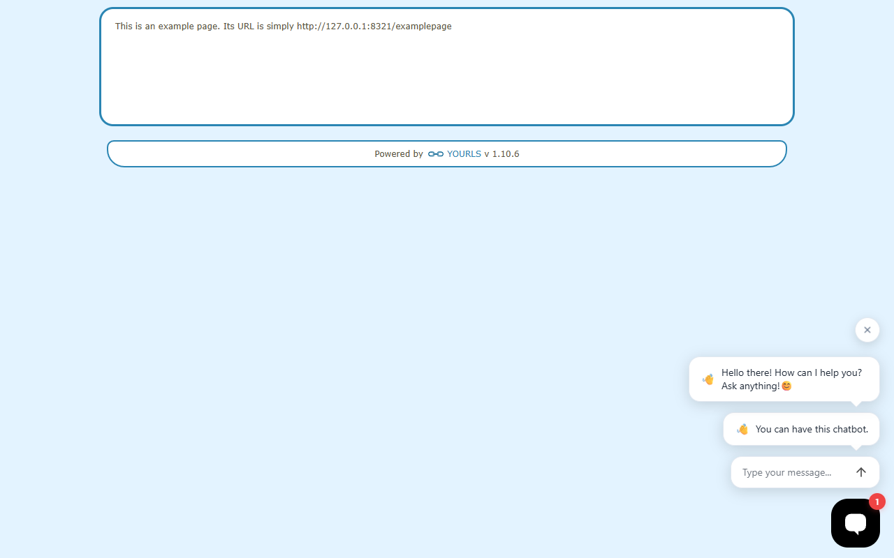
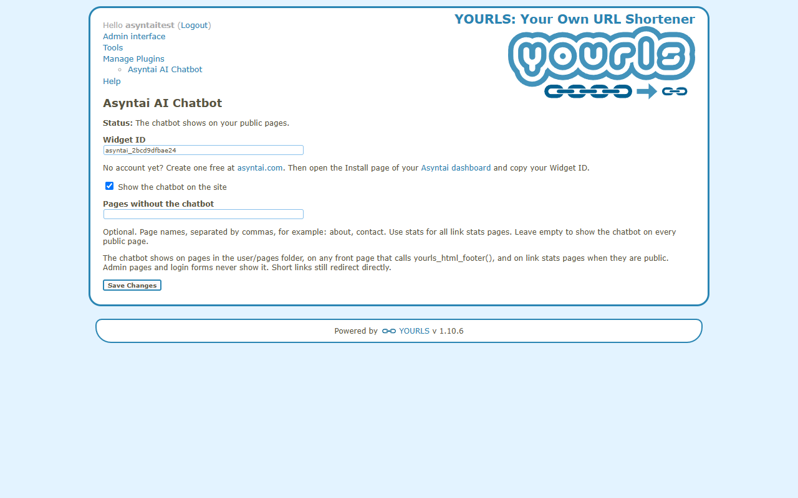

# Asyntai AI Chatbot for YOURLS

[Asyntai](https://asyntai.com) adds an AI chatbot to the public pages of your YOURLS site. It answers visitor questions from your own pages, 24/7, in more than 80 languages.

Full guide: [Asyntai AI chatbot for YOURLS](https://asyntai.com/documentation/installation/yourls/)

## Install

1. Download [asyntai-ai-chatbot-yourls.zip](https://asyntai.com/static/downloads/asyntai-ai-chatbot-yourls.zip), unzip it and upload the `asyntai-ai-chatbot` folder into the `user/plugins` folder of your YOURLS site. You can also run `git clone https://github.com/asyntai/yourls-ai-chatbot.git asyntai-ai-chatbot` in that folder.
2. Open **Manage Plugins** in the admin area and click **Activate** for **Asyntai AI Chatbot**.
3. Open **Manage Plugins > Asyntai AI Chatbot**.
4. Create a free account at [asyntai.com](https://asyntai.com), open the Install page of your [Asyntai dashboard](https://asyntai.com/dashboard) and copy your Widget ID, for example `asyntai_1a2b3c4d5e6f`.
5. Paste the Widget ID (or the whole embed code) and click **Save Changes**.

## Where the chatbot shows

- Pages in the `user/pages` folder that call `yourls_html_footer()`. YOURLS includes `/examplepage`, so you can check there.
- A front page that calls `yourls_html_footer()`, such as one made from `sample-public-front-page.txt`.
- Link stats pages (`your-short-link+`) when they are public. YOURLS makes them private by default. Add `define( 'YOURLS_PRIVATE_INFOS', false );` to `user/config.php` to make them public.

Admin pages and login forms never load the chatbot. Short links still redirect directly.

## Settings

- **Widget ID**: your Asyntai Widget ID. Nothing loads without a valid ID.
- **Show the chatbot on the site**: switch the chatbot on or off without deactivating the plugin.
- **Pages without the chatbot**: page names, separated by commas, for example `about, contact`. Use `stats` for all link stats pages.

## Screenshots

The chatbot on a YOURLS public page:

The settings page:

## How it works

The plugin adds one small script tag before the closing `</body>` tag through the YOURLS `html_footer` action. It changes no core file.

Works with YOURLS 1.9 and newer (tested on 1.9.2 and 1.10.6).

## License

MIT
